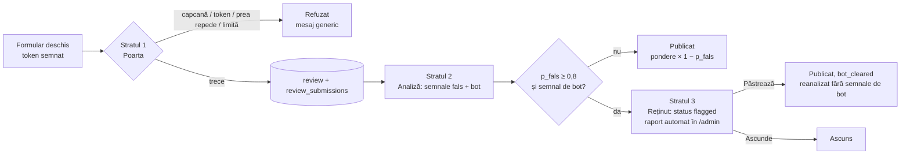

# Sistemul anti-bot pentru review-uri

Cum oprim review-urile scrise de scripturi, conturi false în masă și „ferme” de review-uri, fără să-i pedepsim pe oamenii reali. Completează semnalele de review fals din [`ARHITECTURA.md`](ARHITECTURA.md#potrivirea-localelor-și-analiza-fiecărui-review) (modulul C) și formula de pondere din secțiunea Scoring.

**Ideea de bază:** nu blocăm pe suspiciune. Blocăm doar ce e sigur automat (stratul 1). Restul doar scade ponderea review-ului (stratul 2). Ce e aproape sigur bot nu apare până nu se uită un admin (stratul 3), iar adminul poate oricând să-l elibereze (regula 2: niciun review nu dispare fără decizia unui om).



## Stratul 1: poarta la trimitere

Cod: [`packages/api/src/antibot.ts`](../packages/api/src/antibot.ts) (`checkReviewGate`), chemată din `writeReview` când review-ul vine de pe site.

| Verificare | Regula | De ce |
| --- | --- | --- |
| Câmp capcană (honeypot) | câmpul ascuns `website` trebuie să fie gol | e în afara ecranului, `aria-hidden`, `tabIndex=-1`: un om nu-l vede și nici cititorul de ecran nu-l anunță; scripturile completează toate câmpurile |
| Token de formular | la deschiderea formularului, serverul dă `ora.HMAC(user, local, ora)`; la trimitere trebuie să fie valid, al aceluiași user și local, sub 6 ore | un script care trimite direct, fără să deschidă formularul, n-are token; ora nu se poate falsifica fără cheia serverului |
| Timp minim | formular trimis la ≥ 3 secunde după deschidere | un om nici nu citește întrebările în 3 secunde |
| Limită per cont | max. 5 review-uri / oră și 15 / zi | nimeni nu mănâncă în 5 locuri pe oră |
| Limită cont nou | conturile sub 24 de ore: max. 3 review-uri în prima zi | conturile create în masă sunt folosite imediat |
| Limită per dispozitiv | max. 12 review-uri / oră de pe aceeași amprentă (IP + browser) | mai larg decât per cont, ca wifi-ul unui cămin sau al unei cafenele să nu fie blocat |

Mesajul pentru capcană, token și timp e mereu același („Nu am putut publica review-ul. Reîncarcă pagina…”), ca un script să nu afle ce l-a dat de gol. Limitele au mesaje clare, pentru că un om real le poate atinge.

Cu `client` lipsă (seed, teste, importuri) poarta e sărită. Site-ul trimite întotdeauna `client`.

## Stratul 2: semnalele din analiză

Cod: [`packages/review-analysis/src/rules.ts`](../packages/review-analysis/src/rules.ts) (`botSignals`, reguli pure, fără DB) și [`persist.ts`](../packages/review-analysis/src/persist.ts) (adună datele). Rulează după fiecare review nou și noaptea, odată cu restul analizei.

### Semnale de bot (noi)

| Semnal | Se declanșează când | Pondere |
| --- | --- | --- |
| `botVelocity` | același cont are ≥ 4 review-uri într-o fereastră de 60 de minute (la orice localuri) | 0,50 |
| `copyPaste` | textul (≥ 8 cuvinte) seamănă ≥ 70% (Jaccard pe grupuri de 3 cuvinte) cu un review nativ din ultimele 30 de zile de la **alt** local | 0,60 |
| `sharedDevice` | ≥ 3 conturi diferite au trimis review la **același** local de pe aceeași amprentă, în ±7 zile | 0,60 |
| `tooFast` | formular trimis în < 4 s sau mai repede de 15 caractere/secundă (din token) | 0,40 |
| `spamContent` | linkuri (`http`, `www.`, `.com`, `.xyz`…), telefon/email/WhatsApp/Telegram, un caracter repetat de 7+ ori, < 20% vocale sau > 80% majuscule (la ≥ 20 de litere) | 0,60 |
| `freshAccount` | contul avea sub 10 minute la trimitere | 0,15 |

`tooFast`, `sharedDevice`, `copyPaste` și `freshAccount` folosesc amprenta de trimitere (`review_submissions`), deci se aplică doar review-urilor postate acum pe site, nu celor importate sau din seed.

### Semnale de review fals (existente, modulul C)

| Semnal | Se declanșează când | Pondere |
| --- | --- | --- |
| `burst` | ≥ 5 note maxime la același local în 48 h, de 3× peste ritmul lui obișnuit | 0,35 |
| `similarText` | text ≥ 60% asemănător cu alt review al **aceluiași** local | 0,40 |
| `newAccount` | primul review al contului, fără poză sau istoric | 0,20 |
| `extremeOnly` | autorul dă doar note maxime sau doar minime (≥ 3 review-uri) | 0,20 |
| `ownerOrStaff` | autorul e owner, manager sau angajat al localului | 0,90 |
| `generic` | ≤ 6 cuvinte, doar laude generice („Super! Recomand!”) | 0,15 |

### Formula

Semnalele se combină ca evenimente independente: fiecare „taie” din probabilitatea că review-ul e cinstit.

```
p_fals = 1 − Π (1 − pondere_semnal)          (plafonat la 0,99)
pondere_review = autor × verificare × (1 − p_fals) × vechime × plătit
```

Prima linie e în `fakeProbability` (`rules.ts`), a doua în `reviewWeight` (`packages/scoring/src/weights.ts`). Un semnal singur nu scoate pe nimeni din calcul: doar îi scade greutatea.

### Exemple

| Caz | Semnale | p_fals | Ce se întâmplă |
| --- | --- | --- | --- |
| Om, primul review, scris în 2 minute | `newAccount` | 0,20 | publicat, nota contează ×0,8 (plus ×0,3 pentru cont nou, din formula autorului) |
| Om grăbit, cont făcut acum 3 minute | `newAccount`, `freshAccount` | 0,32 | publicat, ×0,68 |
| 3 conturi de pe același telefon la același local | `sharedDevice`, `newAccount` | 0,68 | publicat, ×0,32; dacă e și rafală (`burst`), 0,79 |
| Bot cu link, trimis în 3,5 s, cont de 40 s | `tooFast`, `spamContent`, `freshAccount`, `newAccount` | 0,84 | **reținut** pentru admin |
| Același cont, același text la 4 localuri într-o oră | `botVelocity`, `copyPaste` | 0,80 | **reținut** pentru admin |

## Stratul 3: reținut pentru admin

Dacă un review nativ are **cel puțin un semnal de bot** și `p_fals ≥ 0,8` (`BOT_RULES.holdProbability`):

1. Primește `status = "flagged"`: nu apare pe pagină și nu intră în scor sau în leaderboard (ele citesc doar `published`).
2. Se deschide automat un raport în `/admin`: „Review reținut de filtrul anti-bot”, cu motivele în cuvinte (`BOT_SIGNAL_LABELS`). E un singur raport per review.
3. Autorul vede „Review-ul tău a ajuns la verificare la un moderator”.
4. Adminul decide:
   - **Păstrează** → `published`, `bot_cleared = true`, reanalizat fără semnalele de bot (doar cele de fals rămân), scorul se recalculează. Analiza nu-l mai reține niciodată.
   - **Ascunde** → `hidden` (nu se șterge), scorul se recalculează.

Pragul cere un semnal de **bot**: un review doar „suspect” (rafală + text asemănător) scade în pondere, dar rămâne public. Așa owner-ii sau concurenții nu pot folosi filtrul ca să ascundă review-uri incomode.

## Date și GDPR

| Ce | Unde | Cât timp |
| --- | --- | --- |
| Amprenta dispozitivului: HMAC-SHA256(cheia serverului, IP + browser), primele 22 de caractere | `review_submissions.client_hash` | 90 de zile, apoi se șterge (jobul de noapte `recalculeaza-scoruri`) |
| Timpul de completare, vârsta contului | `review_submissions.fill_ms`, `account_age_sec` | 90 de zile |
| Semnalele găsite | `reviews.fake_signals` | cât trăiește review-ul |

IP-ul nu se salvează nicăieri. Fără `SESSION_SECRET` amprenta nu se poate recalcula, iar din ea nu se poate afla IP-ul.

## Unde se reglează

Toate pragurile sunt constante, cu numele de mai sus:

- poarta: `GATE_RULES` în `packages/api/src/antibot.ts`;
- semnalele de bot: `BOT_RULES` în `packages/review-analysis/src/rules.ts`;
- ponderile semnalelor: `FAKE_SIGNAL_WEIGHTS`, în același fișier.

După o schimbare, `npm run job -w @tftd/worker -- recalculeaza-scoruri` reanalizează tot.

## Teste

- `packages/review-analysis/src/bot.test.ts`: fiecare semnal, spam / nu e spam, viteza de tastare, pragul de reținere.
- `packages/api/src/antibot.test.ts`: tokenul (alt user, alt local, expirat, oră falsificată), amprenta fără IP. Pe baza locală: capcana, tokenul lipsă, trimiterea instantă, limita conturilor noi, botul reținut și eliberat de admin, 3 conturi pe același dispozitiv. Rulează cu `DATABASE_URL` setat, într-o tranzacție anulată la final.

## Limite cunoscute și ce urmează

- **Botii buni trec de poartă**: un script care deschide formularul și așteaptă câteva secunde ia token și trece de timpul minim. De aceea contează stratul 2 (comportamentul în timp) mai mult decât poarta.
- **IP-uri rotative / VPN** ocolesc `sharedDevice`. Pasul următor: un CAPTCHA invizibil (ex. Cloudflare Turnstile) doar pentru conturile noi sau când poarta vede semnale.
- **`copyPaste` compară cu Jaccard** pe cel mult 2.000 de texte recente. Coloana `reviews.embedding` (pgvector, 384 de dimensiuni) există dar nu e completată; cu embeddings, comparația prinde și parafrazele și scalează la toată baza.
- **Înregistrarea conturilor** nu are încă poartă: aceleași idei (capcană, timp minim, limită per dispozitiv) se pot pune pe `registerUser`.
- **Seed-ul** refolosește câteva șabloane de text, așa că `similarText` apare la majoritatea review-urilor din seed. Nu e o problemă a filtrului, dar ține de minte când compari scorurile din demo.
- La MVP sunt reguli cu puncte. Când avem review-uri marcate de admini (păstrat/ascuns), ponderile se pot învăța dintr-un model simplu (regresie logistică pe aceleași semnale).
